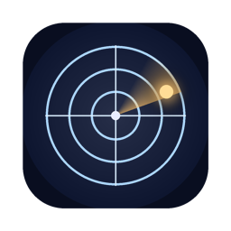
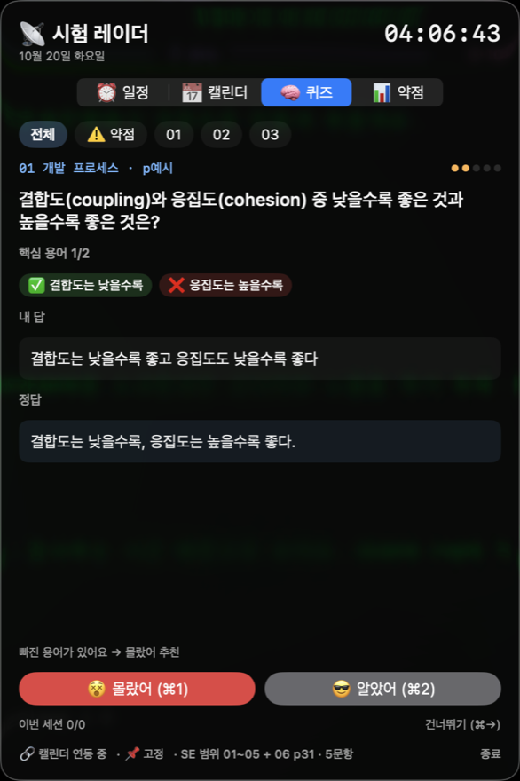

<div align="center">



# 시험 레이더

**메뉴바에서 다음 시험까지 남은 시간을 1초 단위로 세고, 바로 그 자리에서 퀴즈를 푸는 macOS 앱**




</div>

## 💡 왜 만들었나

중간고사 이틀 전, 시험 일정은 캘린더에 있고 복습 문제는 노트에 있고 남은 시간은 머릿속으로 계산하고 있었습니다. 이걸 메뉴바 한 곳에 모았습니다.

서술형 시험에서 자주 틀리는 이유는 개념을 몰라서가 아니라 **강의자료 용어를 정확히 쓰지 않아서**였습니다("구조 기반 테스트"를 "코드 기반"으로 쓰는 식). 그래서 퀴즈는 답을 직접 쓰게 하고, 빠진 핵심 용어를 바로 보여줍니다.

## ✨ 기능

| 탭 | 하는 일 |
|---|---|
| **메뉴바** | `🟢 SE 중간 D-2 · 54:26:39`처럼 다음 시험까지 남은 시간을 1초마다 갱신. 📌 시험 하나를 고정할 수 있음 |
| ⏰ **일정** | 애플 캘린더의 시험·마감 일정을 D-day와 남은 시간으로 나열. 캘린더가 바뀌면 바로 다시 읽음. ✅ 끝낸 일정은 체크해서 카운트다운에서 빼고 숨길 수 있음 |
| 📅 **캘린더** | 월간 달력(캘린더 색 점, 공휴일 빨강), 날짜별 일정, 다가오는 7일, 캘린더별 숨기기. 읽기 전용 |
| 🧠 **퀴즈** | 답을 쓰고 제출하면 문항마다 정한 핵심 용어를 ✅/❌로 채점하고 알았어/몰랐어를 추천. Leitner 5상자 방식이라 틀린 문제가 더 자주 나옴 |
| 📊 **약점** | 챕터별 숙련도, 가장 많이 틀린 문제와 내가 마지막에 쓴 답. **로그인할 때 자동 실행** 토글도 여기 있음 |

## 🚀 시작하기

### 요구사항

- macOS 14 이상 (Apple Silicon)
- Xcode Command Line Tools (`swiftc`, `iconutil`, `codesign`)
- Python 3 + Pillow (아이콘 생성과 문제은행 검사에만 사용)

### 빌드

```bash
git clone https://github.com/DeVentory/exam-radar.git
cd exam-radar
./build.sh                       # ~/Applications/시험 레이더.app 생성
open ~/Applications/시험\ 레이더.app
```

처음 실행하면 macOS가 **캘린더 접근**을 묻습니다. 허용하면 캘린더에서, 거부하면 `exams.json`에서 일정을 읽습니다.

> [!NOTE]
> Dock 아이콘 없이 메뉴바에만 뜨는 앱입니다. 끄려면 창 아래 **종료**를 누르세요.

### 내 환경에 맞추기

[`Sources/Config.swift`](Sources/Config.swift) 한 파일만 고치면 됩니다.

| 설정 | 뜻 |
|---|---|
| `examCalendars` | 시험으로 볼 캘린더 이름 |
| `examPattern` | 시험으로 볼 제목 키워드 (정규식) |
| `courseAlias` | 메뉴바에 쓸 과목 줄임말 (`"소프트웨어공학"` → `"SE"`) |
| `examsJSONPath` | 캘린더를 못 읽을 때 쓰는 시험 목록 파일 |
| `chapterNames`, `quizScope` | 퀴즈 챕터 이름과 범위 설명 |

### 내 문제은행 넣기

`Resources/questions.json`을 만들면 그것으로, 없으면 예시 5문항(`questions.sample.json`)으로 빌드합니다.

```json
{
  "id": "01-05", "ch": "01", "p": "7",
  "q": "블랙박스 테스트와 화이트박스 테스트의 다른 이름은?",
  "a": "블랙박스 = 명세 기반 테스트\n화이트박스 = 구조 기반 테스트",
  "kw": ["명세 기반", "구조 기반"],
  "weak": true,
  "note": "'코드 기반'이 아니라 구조 기반"
}
```

- `kw`: 채점할 핵심 용어. `"A|B"`는 같은 뜻의 대안이고, 첫 번째(A)는 정답 `a` 안에 있어야 합니다.
- `weak`: `true`면 처음부터 "자주 틀림" 상자에서 시작합니다.

`build.sh`가 빌드 전에 [`tools/check_questions.py`](tools/check_questions.py)로 필드, id 중복, 핵심 용어 위치를 검사합니다.

> [!IMPORTANT]
> `Resources/questions.json`은 `.gitignore`에 들어 있습니다. 강의자료에서 옮긴 문제는 저장소에 올리지 마세요.

## ⌨️ 단축키 (퀴즈)

| 키 | 동작 |
|---|---|
| `⌘↩` | 제출 |
| `⌘.` | 모르겠어 (바로 답 보기) |
| `⌘1` / `⌘2` | 몰랐어 / 알았어 |
| `⌘→` | 건너뛰기 |

## 🖼️ 덤: 시험 D-day 바탕화면

[`extras/wallpaper/`](extras/wallpaper)에는 D-day와 자주 틀린 개념 카드를 그린 바탕화면을 매일 0시에 다시 그리고, 시험이 끝나면 원래 배경으로 돌려놓는 스크립트가 있습니다. `make.py` 위쪽의 시험 날짜와 카드 문구를 고친 뒤 설치합니다.

```bash
mkdir -p ~/Pictures/claude-wallpaper && cp extras/wallpaper/make.py ~/Pictures/claude-wallpaper/
cp extras/wallpaper/restore_wallpaper.sh ~/ && chmod +x ~/restore_wallpaper.sh
osascript -e 'tell application "System Events" to get picture of desktop 1' > ~/.wallpaper_backup.txt   # 지금 배경 백업
sed "s#__HOME__#$HOME#g" extras/wallpaper/com.claude.sewallpaper.plist > ~/Library/LaunchAgents/com.claude.sewallpaper.plist
launchctl bootstrap gui/$(id -u) ~/Library/LaunchAgents/com.claude.sewallpaper.plist
```

바로 되돌리려면 `~/restore_wallpaper.sh`를 실행하세요.

## 📁 구조

```
Sources/
  Config.swift       내 환경 설정
  Model.swift        캘린더·시험 읽기, Leitner 퀴즈, 채점, 학습 기록
  Views.swift        메뉴바와 네 개의 탭
Resources/
  questions.sample.json
tools/check_questions.py
extras/wallpaper/    D-day 바탕화면
build.sh             빌드·번들·서명
make_icon.py         아이콘 생성
```

학습 기록은 `~/Library/Application Support/ExamRadar/progress.json`에 저장됩니다.

## ❓ FAQ

<details>
<summary><b>새로 빌드했더니 메뉴바에 안 보여요</b></summary>

새로 빌드한 직후 첫 실행에서는 macOS가 새 바이너리를 검사하느라 10초쯤 늦게 뜰 수 있습니다. 조금 기다리거나 앱을 다시 실행하세요. 메뉴바 아이콘이 많으면 노치 뒤로 숨기도 하니, 다른 메뉴바 아이콘을 줄여 보세요.
</details>

<details>
<summary><b>캘린더 일정이 안 나와요</b></summary>

**시스템 설정 → 개인정보 보호 및 보안 → 캘린더**에서 시험 레이더를 켜세요. 창 아래에 `🔗 캘린더 연동 중`이 보이면 연결된 상태입니다. 그래도 비어 있으면 `Config.swift`의 `examCalendars` 이름이 캘린더 앱의 이름과 똑같은지 확인하세요.
</details>

<details>
<summary><b>종일 일정의 시간은 어떻게 정하나요?</b></summary>

제목에 `0900`, `18:30`처럼 시간이 적혀 있으면 그 시간을 쓰고(2020~2099는 연도로 보고 무시), 없으면 그날 23:59로 봅니다.
</details>

<details>
<summary><b>지우려면?</b></summary>

먼저 📊 약점 탭에서 **로그인할 때 자동 실행**을 끄고(또는 시스템 설정 → 일반 → 로그인 항목에서 제거) 앱을 종료한 뒤:

```bash
rm -rf ~/Applications/시험\ 레이더.app ~/Library/Application\ Support/ExamRadar
defaults delete com.deventory.examradar
```
</details>

## 🤖 만든 과정

2026년 10월, 중간고사 이틀 전 새벽에 [Claude Code](https://claude.com/claude-code)와 함께 하룻밤에 만들었습니다. 강의 PDF에서 문제은행을 만들고, 별도의 검증 에이전트가 PDF 원문과 대조해 용어·쪽 번호 오류를 잡은 뒤 앱에 넣었습니다. 버전별 변경은 [CHANGELOG](CHANGELOG.md)에 있습니다.

## 📄 License

[MIT](LICENSE) © DeVentory
